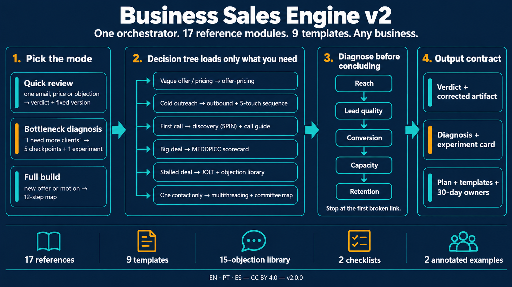
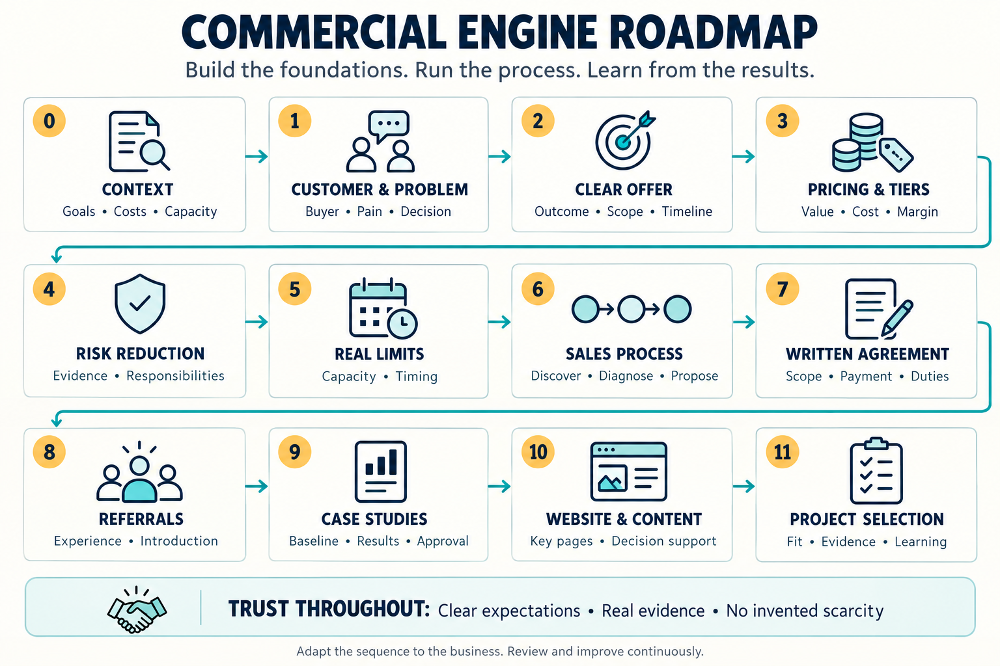
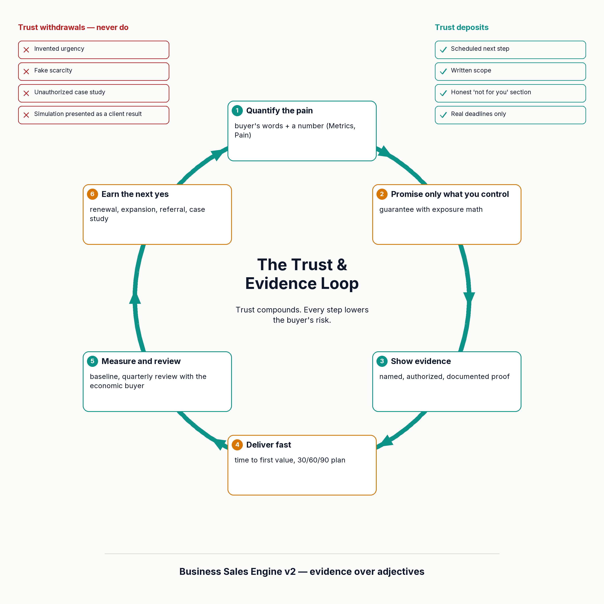

# Business Sales Engine — Claude Skill

**English** · [Português](#português) · [Español](#español)



A Claude skill that designs or reviews the commercial side of any business: offer, pricing and tiers, guarantees, scarcity and urgency, sales process, contract, referrals, case studies and content. Works for services, digital products, SaaS, physical products and local businesses.

| Language | Skill folder | Skill name |
|---|---|---|
| English (main) | [`business-sales-engine/`](business-sales-engine/SKILL.md) | `business-sales-engine` |
| Português | [`motor-comercial-negocios/`](motor-comercial-negocios/SKILL.md) | `motor-comercial-negocios` |
| Español | [`motor-comercial-negocios-es/`](motor-comercial-negocios-es/SKILL.md) | `motor-comercial-negocios-es` |

**v2.0.0 (English) is the current version**: an orchestrator `SKILL.md` plus references, templates, objection library, checklists, examples, trends and a reading list (see its `CHANGELOG.md`). The Portuguese and Spanish folders are still v1 (single file) and lag behind v2.

## What it covers (v2)

| Part | Content |
|---|---|
| `SKILL.md` | Orchestrator: 3 modes (quick review, bottleneck diagnosis, full build), decision tree, stage gates, output contracts |
| `references/` (17) | Offer and pricing, metrics, qualification (MEDDPICC), discovery (SPIN, Mom Test), objections, JOLT, negotiation, multithreading, outbound, narrative, founder-led sales, PLG/PQL, psychology, guarantees, delivery and retention, content, AI in sales |
| `templates/` (9) | MEDDPICC scorecard, discovery guide, 5-touch sequence, cold-call scripts, buying-committee map, business case, pitch narrative, experiment card, pricing-tier worksheet |
| `objections/`, `checklists/`, `examples/` | 15-objection library, deal review, post-call rubric, annotated examples |
| `trends.md`, `reading-list.md`, `CHANGELOG.md` | Six-month review cycle, sources by step, version history |



Trust runs through every step: clear expectations, measured results and proof that earns the next opportunity.



## Installation

**Claude app/web:** zip the folder of your language and upload it in the skills area of your account.

**Claude Code:**

```bash
git clone https://github.com/C48H74/business-sales-engine.git
cp -r business-sales-engine/business-sales-engine ~/.claude/skills/
```

## Usage

> Use the business-sales-engine skill to review the offer and pricing of my [describe the business].

The skill first asks for what is missing (audience, current price, cost, capacity, proof) and returns a diagnosis, rewritten offer, tier table, guarantees, sales script and next steps.

## Sources

Original, paraphrased synthesis of public ideas from Alex Hormozi, Russell Raath, Jonathan Stark, Harrison Baron, John Jantsch, Joel Klettke, Andy Crestodina and ADALID Abogados. No transcripts or copied passages.

Educational content. Not a substitute for legal, accounting or tax advice.

---

## Português

Skill para o Claude que desenha ou revisa a parte comercial de qualquer negócio: oferta, preço e camadas, garantias, escassez e urgência, venda, contrato, indicações, estudos de caso e conteúdo.

- Pasta: [`motor-comercial-negocios/`](motor-comercial-negocios/SKILL.md)
- Instalação no Claude Code: `cp -r business-sales-engine/motor-comercial-negocios ~/.claude/skills/`
- Uso: *"Use a skill motor-comercial-negocios para revisar a oferta e o preço do meu [negócio]."*

Síntese própria e parafraseada; não contém transcrições. Conteúdo educativo, não substitui orientação jurídica, contábil ou fiscal.

## Español

Skill para Claude que diseña o revisa la parte comercial de cualquier negocio: oferta, precio y niveles, garantías, escasez y urgencia, venta, contrato, recomendaciones, casos de éxito y contenido.

- Carpeta: [`motor-comercial-negocios-es/`](motor-comercial-negocios-es/SKILL.md)
- Instalación en Claude Code: `cp -r business-sales-engine/motor-comercial-negocios-es ~/.claude/skills/`
- Uso: *"Usa la skill motor-comercial-negocios-es para revisar la oferta y el precio de mi [negocio]."*

Síntesis propia y parafraseada; no contiene transcripciones. Contenido educativo, no sustituye el asesoramiento jurídico, contable o fiscal.

---

## License

[CC BY 4.0](https://creativecommons.org/licenses/by/4.0/) — use, adapt and redistribute, including commercially, with credit to the author.

## Author

Daniel de Souza Paixão — [LinkedIn](https://www.linkedin.com/in/daniel-paixao-b5988230)
